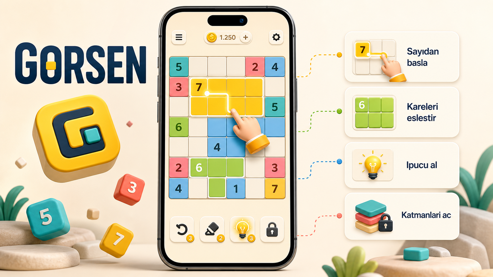

# Puzzle Area



Puzzle Area is a mobile logic game built with React Native and Expo. Players use the numbers on the board to identify rectangular regions with exactly the indicated number of cells. Completing every region solves the level and unlocks the next challenge.

The project is published as a portfolio case study for **Görkem Şenol / Görsen Games**. It demonstrates a production mobile game architecture, deterministic content generation, persistent progression, monetization integrations, and responsive layouts for phones and tablets.

## Highlights

- 1,290 deterministic puzzle levels across 10 layer groups
- Boards ranging from the Starter collection to 15x11
- Difficulty progression, special irregular board layouts, and duplicate prevention
- Move-based one-to-three-star scoring and animated completion flow
- Layer unlocking, hints, two in-game currencies, and save-data migrations
- Apple App Store and Google Play in-app purchases
- Interstitial and rewarded ads, plus a permanent remove-ads purchase
- Turkish and English interfaces
- Responsive iPhone, iPad, and Android phone/tablet layouts
- Local progress persistence with AsyncStorage

## Technology

- React Native 0.81
- Expo SDK 54
- React 19
- Expo IAP
- Google Mobile Ads
- AsyncStorage
- Expo Haptics and Store Review

## Project Structure

```text
.
|-- App.js                    # Navigation, UI, progression, economy, ads and purchases
|-- src/levels.js             # Deterministic puzzle generation and board definitions
|-- assets/                   # Runtime artwork, icons, audio and store visuals
|-- android/                  # Android native project generated for Expo modules
|-- scripts/                  # Asset preparation utilities
|-- tools/                    # Screenshot and promotional-media helpers
|-- app.json                  # Expo, iOS and Android application configuration
`-- eas.json                  # EAS development and production build profiles
```

## Run Locally

### Requirements

- Node.js 20 LTS or another version supported by Expo SDK 54
- Android Studio and an Android emulator for Android development
- macOS with Xcode for local iOS builds, or an EAS account for cloud builds

Install dependencies:

```bash
npm ci
```

Run the native Android development build:

```bash
npx expo run:android
```

Run on iOS from macOS:

```bash
npx expo run:ios
```

This app uses native advertising and purchase modules, so a native development build is required. Expo Go does not include those modules.

## Store Services

Purchases, ads, and production builds require developer-owned App Store Connect, Google Play Console, AdMob, and EAS configuration. Signing keys, store credentials, certificates, generated binaries, and local environment files are intentionally excluded from this repository.

- [Download on the App Store](https://apps.apple.com/app/id6800594940)
- [Get it on Google Play](https://play.google.com/store/apps/details?id=com.gorsengames.puzzlearea)
- [Privacy policy](PRIVACY_POLICY.md)

## Portfolio Scope

The repository is public for source review and portfolio presentation. Game artwork, branding, level content, and source code remain the property of Görsen Games unless a separate license states otherwise. No permission is granted to publish copies of the game or reuse its commercial assets.
